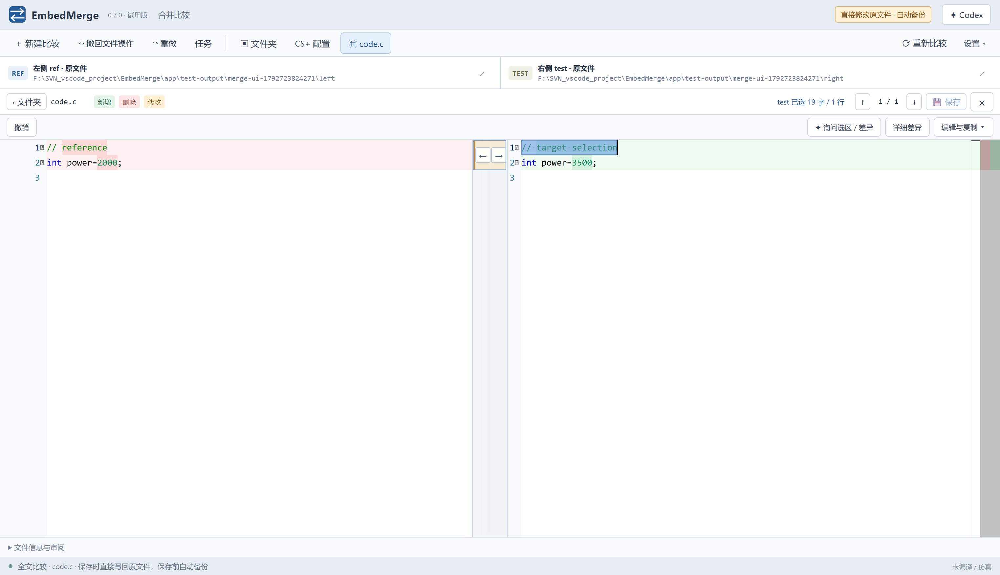

# EmbedMerge｜嵌入式工程比较与合并工具

**把两份工程的代码、CS+ 配置和 MATLAB 模型/数据差异放在同一个工作台里查看，再决定哪些改动保留、哪些需要合并。**

面向需要做版本归档、项目移植、参数复核和改动交接的嵌入式软件同事。当前为 **0.11.5 Windows x64 试用版**，维护人：[@chenchenz1235](https://github.com/chenchenz1235)。

[下载体验](https://github.com/chenchenz1235/CCSpt/releases/tag/embedmerge-v0.11.5) · [三分钟看懂](#三分钟体验一次) · [源码与 DIY](source/README.md) · [反馈问题](https://github.com/chenchenz1235/CCSpt/issues/new)

## 它解决什么问题

| 工作中遇到的情况 | 用 EmbedMerge 做什么 |
|---|---|
| 两份工程目录大，不容易找出真正改了哪些文件 | 双侧目录浏览，筛选差异、单侧文件与类型，展开后看具体内容 |
| C/H 文件有变化，想只合入其中一段 | 双栏文本比较、差异定位、逐块向左/右合并、编辑及保存 |
| CS+ 工程名字不同，寄存器配置和工程选项也有变化 | 配对 `.scfg` / `.mtpj`，按模块与属性查看配置差异 |
| 生成代码相似，但模型参数或 MAT/Bus 数据可能变了 | 调用 MATLAB 比较模型/数据，汇总证据，按需打开官方比较窗口 |
| 看到了差异，想结合上下文理解影响 | 把当前文件、选区或差异交给 Codex，按需读取关联文件辅助分析 |
| 比较中断了，或者复制、删除后需要回退 | 恢复比较任务与草稿，查看备份和文件操作撤回；仍需核对实际操作结果 |

**体验重点：从“找出不一样”继续到“查看代码、配置、模型的相关证据，再审阅和合并”。** 模型差异与 AI 解释都不能代替编译、仿真或上板验证。

## 界面长什么样

上图是 0.7.0 的已有合成样例截图：左右两侧查看代码，差异处可向左/右复制，也能手动编辑。截图只展示界面，不代表已完成真实工程验证。

## 三分钟体验一次

**第一轮不需要 MATLAB，也不需要登录 Codex。** 先用随包合成样例了解目录和文本比较：

1. 下载并完整解压 ZIP，运行 `EmbedMerge.exe`。
2. 在首页点“打开 fixtures 示例”，程序会准备随包合成样例；无需查找磁盘路径。
3. 示例加载完成后打开 `src/protocol.c`：看路由函数调用的差异；再看 `include/product_config.h` 中模拟的配置变化。
4. 对照只在一侧存在的文件，以及 `src/comment_only.c` 的注释变化，看看哪些是你真正关心的改动。
5. 在副本里尝试向左/右合并一处差异、保存，再查看备份或撤回操作。

完成后再拿一个**脱敏工程副本**试试。模型/MAT 比较需配置本机 MATLAB；AI 可选择本机 Codex 或 Claude Code CLI，使用个人登录。

## 为什么值得同事试用

如果你平时要在工程目录、C/H、CS+ 配置、MATLAB 模型和数据之间来回核对，可以先试它能否把这些操作串到同一个任务里。反馈一个具体场景就很有价值，例如：

- “这两个版本的参数和配置，能不能更快找到关键变化？”
- “我要保留 A 的一段改动、B 的另一段，合并操作是否顺手？”
- “某个差异看不懂，Codex 得到的上下文是否准确、解释是否有依据？”

当前是员工体验阶段，优先收集**影响使用的漏项、误判和操作不便**，不预设它已经适合所有工程。

## 下载与运行

- [下载 EmbedMerge 0.11.5 ZIP](https://github.com/chenchenz1235/CCSpt/releases/download/embedmerge-v0.11.5/EmbedMerge-0.11.5-windows-x64.zip)，约 155.5 MiB。
- [校验文件 SHA256SUMS.txt](https://github.com/chenchenz1235/CCSpt/releases/download/embedmerge-v0.11.5/SHA256SUMS.txt)。
- [发布记录与验证范围](https://github.com/chenchenz1235/CCSpt/releases/tag/embedmerge-v0.11.5)。

将整个压缩包解压到可写的固定目录，例如 `D:\Tools\EmbedMerge`，双击 `EmbedMerge.exe`。无需让员工使用开发者的项目目录，也不要只拿 EXE 单文件。不要放在只读目录或直接从压缩包启动。

**首次请用工程副本试用。直接比较会操作所选原文件；保存、复制、覆盖和删除都可能改动文件。** 新建比较时可勾选“创建独立副本”。程序有备份与撤回设计，但本次未重测这些运行行为，不能将其作为无需检查操作结果的保证。

## 功能与依赖

| 功能 | 依赖及范围 |
|---|---|
| 文本、文件和目录比较 | 压缩包自带运行时；本次未验证所有 Windows 版本 |
| MATLAB 模型/MAT 比较 | 本机安装 MATLAB，顶部“MATLAB 设置”中配置 matlab.exe；不按年份设置白名单，实际操作依赖函数、工具箱及许可证；不需要额外 MATLAB MCP |
| AI 辅助 | 本机 Codex 或 Claude Code CLI 与个人登录；原生工具、技能和 MCP 取决于本机配置；专用参数审核仍使用 Codex |

MATLAB 通过本机进程及 AutomationServer 连接。Codex 保留项目沙箱和 on-request 确认；Claude 使用默认权限规则及软件内确认。AI 可配置软件设置并打开页面；原生文件工具可能直接写工作目录。

`data/` 在员工电脑运行时自行生成，包含个人任务、备份及日志；升级前保留自己的数据。此发布包已排除开发者的整个 data 目录。包内《打包与AI接入说明.txt》说明本版设置入口、配置文件、权限和验证边界；《使用说明.txt》保留历史功能记录，冲突时以当前说明为准。

## 0.11.5 更新与验证

供同事试用的 Windows x64 版本。完整解压 ZIP 后运行 EmbedMerge.exe，首次请使用工程副本；升级前保留旧版本旁的个人 data/。

本版主要修复：

- 两侧路径先加载、可直接修改，点击“开始比较”后执行；修复文件夹双击打不开、无效路径误选旧目录等操作问题。
- 关闭文件、返回目录、只读问答不再触发整目录重扫；保存仅更新当前文件，直接文件比较支持外部更新刷新并保护草稿。
- 无工程时也能打开 MATLAB 设置、手填或由 AI 查找配置路径。取消年份白名单，允许 R2024a 等版本，实际比较仍依赖本机 MATLAB、所需工具箱和许可证。
- 软件内 Codex / Claude Code 支持填入设置、路径和打开对应页面。放宽工作预算，保留原生工具、技能及本机配置的 MCP。
- Claude Code 改用默认权限规则，待确认操作可在软件内允许/拒绝，支持补充问题。未启用跳过权限检查；专用参数审核按钮仍使用 Codex。

验证：开发副本单元测试 140 项，139 通过、1 项因文件系统不支持硬链接跳过；打包 EXE 的常规操作 14 项、Claude 界面 7 项和权限模拟 7 项通过。公开源码另行运行测试及构建，结果见源码 README。

已知验证边界：AI 权限链路使用脚本模拟 CLI，经过真实 EXE、认证 MCP 和界面，不代表真实模型推理已通过。真实 Claude CLI 2.1.293 在隔离测试中退出但无输出、未请求本地模拟接口，独立调用也复现；真实账号端到端文件操作尚未验证通过。MATLAB 多版本配置和启动路由经过模拟，未逐版本运行实际模型比较。详见包内《打包与AI接入说明.txt》。

普通文本比较不需要安装 AI 或 MATLAB；相关功能使用接收方本机工具及个人登录。原生 AI 文件工具可以直接写工作目录，请用工程副本试用。发布包排除个人任务、data、凭据、日志和私有固件运行配置。

附件：EmbedMerge-0.11.5-windows-x64.zip 与 SHA256SUMS.txt。源码固定在 embedmerge-v0.11.5 标签下的 labs/apps/EmbedMerge/source。

- 发布 ZIP 的 88 个条目已逐项回读核对清单长度和 SHA-256；不附带私有固件配置。
- ZIP SHA-256：`0a587b0f007dd887247c57cf452bdd23306541ddba38134730b4399b2d941279`。

## 问题反馈

[提交问题](https://github.com/chenchenz1235/CCSpt/issues/new)，附软件版本、操作步骤、预期与实际结果；可用脱敏截图或最小样例。公开反馈不要附公司工程、客户资料、个人任务目录或凭据。

本次提供成品包与经过筛选的源码，排除整个开发目录及其个人数据。Electron 软件包内仍含运行所需脚本与资源，不应将它视为保密封装。随包第三方许可证与声明保留；EmbedMerge 本身尚未另行声明开源许可证。

## 开发源码与 DIY

[浏览开发源码与构建说明](source/README.md)。保留 app 与 new-project-kit/fixtures 的相邻结构；在 app 中安装依赖、运行测试及构建。公开副本包含合成样例，未包含实际公司工程。公开副本测试和构建结果见 [源码说明](source/README.md)，真实调用边界见上文。
