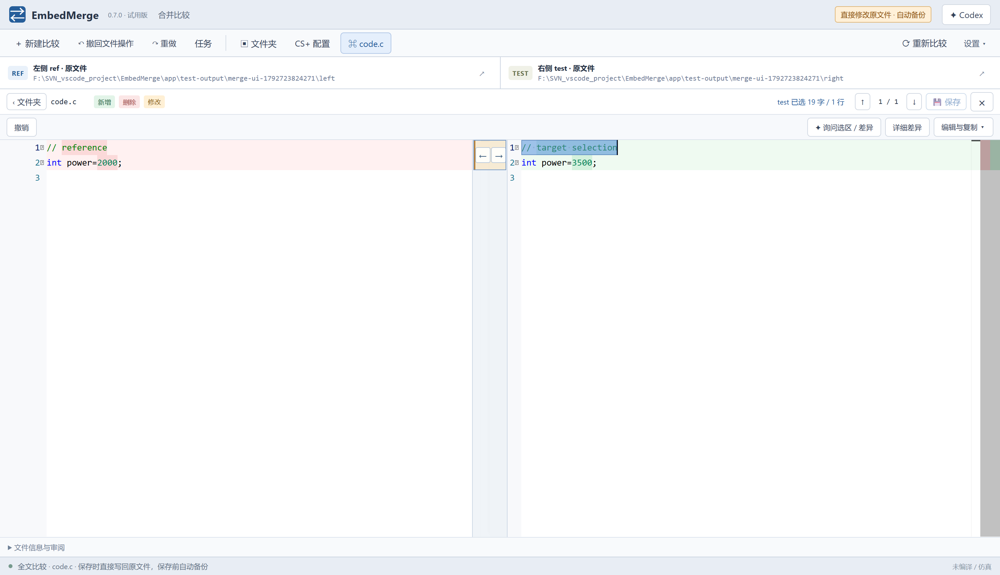

# EmbedMerge｜嵌入式工程比较与合并工具

**把两份工程的代码、CS+ 配置和 MATLAB 模型/数据差异放在同一个工作台里查看，再决定哪些改动保留、哪些需要合并。**

面向需要做版本归档、项目移植、参数复核和改动交接的嵌入式软件同事。当前为 **0.7.0 Windows x64 试用版**，维护人：[@chenchenz1235](https://github.com/chenchenz1235)。

[下载体验](https://github.com/chenchenz1235/CCSpt/releases/tag/embedmerge-v0.7.0) · [三分钟看懂](#三分钟体验一次) · [源码与 DIY](source/README.md) · [反馈问题](https://github.com/chenchenz1235/CCSpt/issues/new)

## 它解决什么问题

| 工作中遇到的情况 | 用 EmbedMerge 做什么 |
|---|---|
| 两份工程目录大，不容易找出真正改了哪些文件 | 双侧目录浏览，筛选差异、单侧文件与类型，展开后看具体内容 |
| C/H 文件有变化，想只合入其中一段 | 双栏文本比较、差异定位、逐块向左/右合并、编辑及保存 |
| CS+ 工程名字不同，寄存器配置和工程选项也有变化 | 配对 `.scfg` / `.mtpj`，按模块与属性查看配置差异 |
| 生成代码相似，但模型参数或 MAT/Bus 数据可能变了 | 调用 MATLAB 比较模型/数据，汇总证据，按需打开官方比较窗口 |
| 看到了差异，想结合上下文理解影响 | 把当前文件、选区或差异交给 Codex，按需读取关联文件辅助分析 |
| 比较中断了，或者复制、删除后需要回退 | 恢复比较任务与草稿，查看备份和文件操作撤回；仍需核对实际操作结果 |

**体验重点：从“找出不一样”继续到“查看代码、配置、模型的相关证据，再审阅和合并”。** 模型差异与 AI 解释都不能代替编译、仿真或上板验证。

## 界面长什么样

上图是 0.7.0 的已有合成样例截图：左右两侧查看代码，差异处可向左/右复制，也能手动编辑。截图只展示界面，不代表已完成真实工程验证。

## 三分钟体验一次

**第一轮不需要 MATLAB，也不需要登录 Codex。** 先用随包合成样例了解目录和文本比较：

1. 下载并完整解压 ZIP，运行 `EmbedMerge.exe`。
2. 点“新建比较”，左侧选 `resources/fixtures/ref`，右侧选 `resources/fixtures/test`；勾选“创建独立副本”。
3. 打开 `src/protocol.c`：看路由函数调用的差异；再看 `include/product_config.h` 中模拟的配置变化。
4. 对照只在一侧存在的文件，以及 `src/comment_only.c` 的注释变化，看看哪些是你真正关心的改动。
5. 在副本里尝试向左/右合并一处差异、保存，再查看备份或撤回操作。

完成后再拿一个**脱敏工程副本**试试。想体验模型/MAT 比较时配置 MATLAB R2024b；想体验 AI 分析时安装并登录本机 Codex CLI。

## 为什么值得同事试用

如果你平时要在工程目录、C/H、CS+ 配置、MATLAB 模型和数据之间来回核对，可以先试它能否把这些操作串到同一个任务里。反馈一个具体场景就很有价值，例如：

- “这两个版本的参数和配置，能不能更快找到关键变化？”
- “我要保留 A 的一段改动、B 的另一段，合并操作是否顺手？”
- “某个差异看不懂，Codex 得到的上下文是否准确、解释是否有依据？”

当前是员工体验阶段，优先收集**影响使用的漏项、误判和操作不便**，不预设它已经适合所有工程。

## 下载与运行

- [下载 EmbedMerge 0.7.0 ZIP](https://github.com/chenchenz1235/CCSpt/releases/download/embedmerge-v0.7.0/EmbedMerge-0.7.0-windows-x64.zip)，约 157.5 MiB。
- [校验文件 SHA256SUMS.txt](https://github.com/chenchenz1235/CCSpt/releases/download/embedmerge-v0.7.0/SHA256SUMS.txt)。
- [发布记录与验证范围](https://github.com/chenchenz1235/CCSpt/releases/tag/embedmerge-v0.7.0)。

将整个压缩包解压到可写的固定目录，例如 `D:\Tools\EmbedMerge`，双击 `EmbedMerge.exe`。无需让员工使用开发者的项目目录，也不要只拿 EXE 单文件。不要放在只读目录或直接从压缩包启动。

**首次请用工程副本试用。0.7.0 默认直接操作所选原文件；保存、复制、覆盖和删除都可能改动文件。** 新建比较时可勾选“创建独立副本”。程序有备份与撤回设计，但本次未重测这些运行行为，不能将其作为无需检查操作结果的保证。

## 功能与依赖

| 功能 | 依赖及范围 |
|---|---|
| 文本、文件和目录比较 | 压缩包自带运行时；本次未验证所有 Windows 版本 |
| MATLAB 模型/MAT 比较 | 员工本机需要 MATLAB R2024b，代码严格检查版本；填写 matlab.exe 路径；不需要额外 MATLAB MCP |
| AI 辅助 | 目前仅支持 Codex，需本机 Codex CLI 与个人登录；未接入其他 AI 服务，不提供共享凭据 |

MATLAB 通过本机进程及 AutomationServer 连接，应用内 Codex 禁用了外部 MCP；安装 MATLAB MCP 不能替代 MATLAB R2024b。本次已核对连接代码与发布文件一致。

`data/` 在员工电脑运行时自行生成，包含个人任务、备份及日志；升级前保留自己的数据。此发布包已排除开发者的整个 data 目录。随包的“快速开始.txt”针对当前版本；“使用说明.txt”保留历史功能记录，旧版条款与 0.7.0 有冲突时以当前版本为准。

## 本次发布检查

- 包内版本：0.7.0；EXE 架构：Windows x64。
- 315 条原构建清单逐项核对文件长度及 SHA-256。
- 发布压缩包共 318 个文件，逐项回读核对 SHA-256，未包含 data/。
- 排除了开发者的任务、日志及缓存；做了常见凭据文件名和密钥格式筛查。这不是完整的安全审计。
- 本次未重跑软件 GUI、模型仿真、AI 端到端调用或实机验证；历史验收记录不能替代本次验证。

压缩包 SHA-256：`b58f8d8845f23bbf38b22bc01df2e2c2a036d03d3018cf67e8efb92e11833643`。

## 问题反馈

[提交问题](https://github.com/chenchenz1235/CCSpt/issues/new)，附软件版本、操作步骤、预期与实际结果；可用脱敏截图或最小样例。公开反馈不要附公司工程、客户资料、个人任务目录或凭据。

本次分发成品包，不导入整个开发工程。Electron 软件包内仍含运行所需脚本与资源，不应将它视为保密封装。随包第三方许可证与声明保留；EmbedMerge 本身尚未另行声明开源许可证。

## 开发源码与 DIY

[浏览开发源码与构建说明](source/README.md)。保留 app 与 new-project-kit/fixtures 的相邻结构；在 app 中安装依赖、运行测试及构建。公开副本包含合成样例，未包含实际公司工程。当前副本前端构建通过，59 项单元测试通过、2 项跳过；GUI、真实 MATLAB/Codex 与重新打包未在本次验证。
